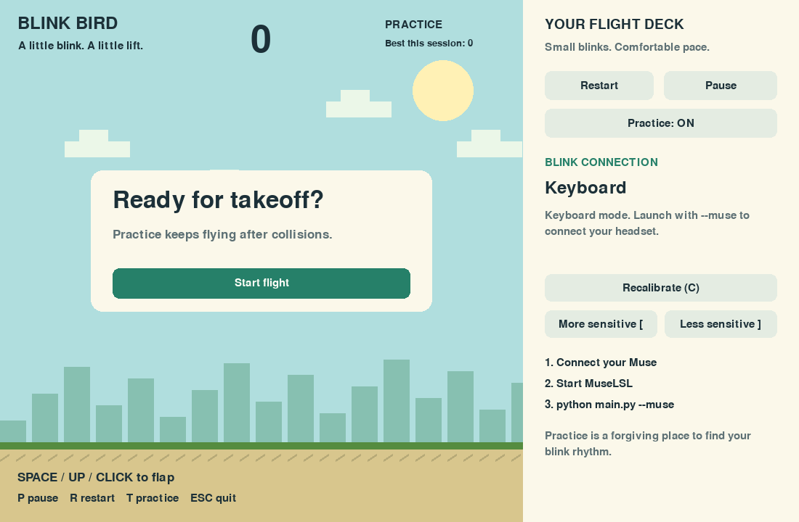

# Blink Bird
A comfortable blink-controlled Flappy Bird game with guided Muse calibration.
Start in forgiving practice mode; switch to Challenge when ready.



## Quick start (Python 3.10–3.12 recommended)
Extract the ZIP, then open a terminal in the extracted **blink-bird** folder.
On macOS:
```bash
python3 -m venv .venv
source .venv/bin/activate
python -m pip install -r requirements.txt
python main.py
```
Windows PowerShell activation: `.venv\Scripts\Activate.ps1`.
If activation is restricted, invoke `.venv\Scripts\python.exe` directly.

## Muse setup
Install the extra dependencies in the same environment:
```bash
python -m pip install -r requirements-muse.txt
```
Keep your existing MuseLSL streaming setup running in a separate terminal, then:
```bash
python main.py --muse
```
This game receives EEG through LSL; it does not pair with Bluetooth or start
MuseLSL itself. If you do not already have MuseLSL, install it in your streaming
environment with `python -m pip install muselsl`, then use `muselsl list` and
`muselsl stream --address YOUR_MUSE_ADDRESS`. Quit other applications that hold
the headset's Bluetooth connection.

If multiple streams are present:
```bash
python main.py --muse --stream-name "EXACT_LSL_NAME"
```
AF7/AF8 channel labels and explicit uV, mV, or V units are required. Unknown
metadata produces a visible connection message, not a guessed channel mapping.
If pylsl reports a missing native liblsl library on macOS, install liblsl
(e.g. `brew install labstreaminglayer/tap/lsl`) and follow pylsl's native-library
setup for your architecture. The keyboard game remains available.

## Calibration and first flight
1. Let the headset settle for 1.5 seconds.
2. Relax and look forward for 5 seconds; natural blinking is fine.
3. Make about five comfortable blinks during the 10-second guided phase.
   There is no required two-second interval.
4. Watch the signal plot and blink counter. Test natural blinks before starting.
5. Click **Start flight**. Blink to flap; Space, Up and a click in the playfield
   also work.
6. If blinks are missed, click **More sensitive** once or twice. If motion causes
   extra flaps, click **Less sensitive** or recalibrate.

Calibration always completes with usable defaults, even when few blinks were
found; the interface tells you when the estimate has limited evidence. A flat
stream cannot provide blink control, but never locks up the game. Sensitivity
adjustments do not require recalibration. Recalibration resets the round.

## Controls
| Action | Control |
| --- | --- |
| Flap / start / retry | Space, Up, click playfield or Start |
| Simulate blink | B |
| Pause / resume | P or button |
| Restart to ready screen | R or button |
| Practice / Challenge | T or button |
| Recalibrate | C or button |
| Easier / harder detection | [ / ] or buttons |
| Exit | Escape or window close |

Practice ignores collisions and clamps the bird inside the playfield. Challenge
ends the round on a collision. Both use gentle physics (gravity 180 px/s²,
flap -180 px/s, pipe speed 105 px/s, gap 250 px). Returning to the same height
takes approximately two seconds after a flap; earlier blinks allow adjustment.
Pause on window focus loss is intentional. Signal warnings do not pause play;
keyboard and click input remain usable during a disconnect.

## What changed
- Early triggering after 16 ms above threshold, instead of waiting for the blink
  to finish. Causal 1–15 Hz filtering still contributes some delay.
- 220 ms debounce plus a 40 ms low-signal rearm prevents repeated counts from one
  blink. This is not a blink-rate shutdown or a two-second lockout.
- Robust baseline (median/MAD), a gentler blink-based threshold, and bounded,
  functional sensitivity adjustment.
- Bad samples reset only filter state; motion has no permanent error latch.
- Short LSL pulls, bounded buffering, corrected timestamps, stale-event rejection
  (200 ms sample window), and automatic connection retries.
- Persistent calibration across short timestamp gaps; full reconnection starts
  a fresh calibration. Outdated samples are never replayed as delayed flaps.
- Framerate-independent physics, corrected pipe spacing, practice ceiling/floor
  behavior, resizable letterboxed window, click controls, signal plot and progress.
- Keyboard mode needs only pygame. Muse imports occur only in Muse mode.
- No raw EEG is saved. Session scores reset when the application closes.

## Project map
| File | Purpose |
| --- | --- |
| main.py | Launch the application |
| blinkbird/app.py | UI, drawing, controls, main loop |
| blinkbird/model.py | Flight physics, pipes, score and collisions |
| blinkbird/detector.py | Calibration, filtering, blink recognition |
| blinkbird/stream.py | LSL connection, timestamps and recovery |
| blinkbird/events.py | Thread-safe, expiring input event |
| requirements.txt | Keyboard dependencies |
| requirements-muse.txt | Muse dependencies |
| tests/test_core.py | Synthetic detector and game regression tests |
| tests/lsl_check.py | Real local LSL transport with synthetic EEG |
| docs/GITHUB_SETUP.md | New and existing repository instructions |

## Validation and limits
Run from the project root:
```bash
python -m unittest discover -s tests -v
python main.py --smoke-test
PYTHONPATH=. python tests/lsl_check.py
```
The LSL test needs Muse dependencies and a working native liblsl. On Windows,
set `$env:PYTHONPATH="."` before running the script.

Tests cover half-second-spaced synthetic blinks, chunk-size independence,
bad-sample and movement recovery, flat input, sensitivity, timestamp rejection,
pause/collisions, and event expiry. Synthetic timing is not measured Bluetooth
or end-to-end headset latency. The displayed sample age is transport age of the
latest received sample, not total blink-to-screen latency.

Arbitrary movement can resemble blinks in frontal EEG. This version stays
running through motion and connection problems, but cannot promise perfect
blink detection under every movement or poor electrode contact. A lower
threshold trades fewer missed blinks for more unintended flaps. Test with real
users before relying on accuracy measurements.

## Design reference
Inspired by the green pipes, yellow bird, sky, ground, and simple restart flow
in https://github.com/arevish/Flappybird-GUI (reviewed November 7, 2026).
Artwork is drawn procedurally in this project. No upstream sprites, audio,
executables, or source files are bundled. The uploaded Blink Bird code was
reorganized and revised; this is a separate project, not a patch to that repo.
